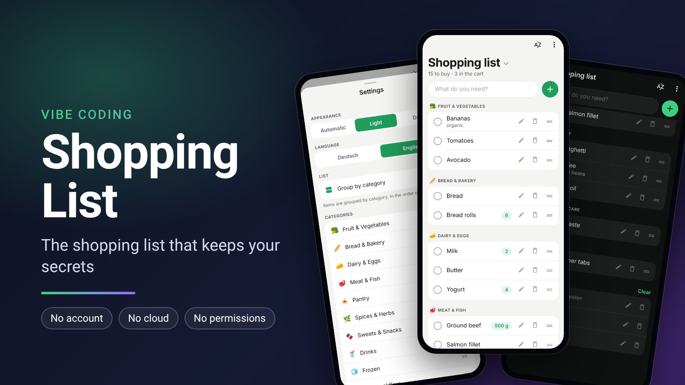
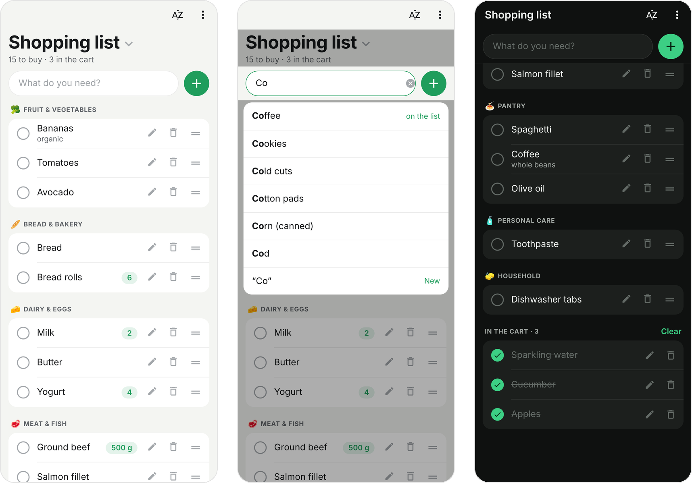
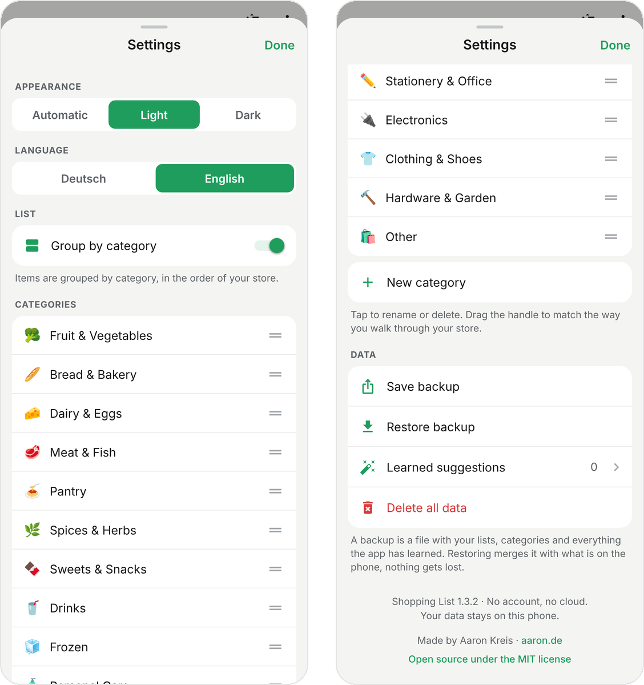

# Shopping List

<p align="center">
  
</p>

<p align="center">
  <b>A shopping list for Android that keeps your data on your phone.</b><br>
  No account · No cloud · No permissions · English and German
</p>

<p align="center">
  <a href="https://github.com/netperformance/ShoppingList/releases">Download APK</a> ·
  <a href="#english">English</a> ·
  <a href="#deutsch">Deutsch</a> ·
  <a href="LICENSE">MIT License</a>
</p>

<p align="center">
  
</p>

<p align="center">
  
</p>

## English

### About the app

Shopping List is a shopping list app for Android. No account, no cloud, no connection to any third party service. All data stays in a database on your phone.

The app is available in German and English.

### Features

- **Quick entry:** The input field sits at the top below the title, so the keyboard never covers it. From the first letter on, the app suggests products from a catalog of about 2,700 English and 2,900 German products: groceries, drugstore, pharmacy, pet supplies, stationery, electronics, clothing, hardware and garden. Quantities are recognized in the input, for example `2 Milk`, `500g Ground beef`, `Yogurt x4`, `2 cans Tomatoes` or `Eggs 12`.
- **Sorted by category:** Items are grouped by category. The order of the categories can be changed in the settings by dragging the handle. A switch in the settings turns grouping off, so all items are shown in one list. The category of each item is kept.
- **Item order:** New items appear at the bottom of their category and can be moved with the handle on the right. The A to Z button at the top sorts the items within each category alphabetically, the order of the categories stays the same (with undo).
- **Custom categories:** Create, rename and delete categories in the settings (with undo). The icon is chosen from a searchable selection. Items of a deleted category appear under "Other".
- **Check off:** Tap an item to check it off, it moves to "In the cart". "Clear" removes all checked items.
- **Edit:** The pencil next to an item or a long press opens quantity, note and category. The app remembers the chosen category for this product and applies it to all items of the same product on all lists.
- **Delete:** Use the trash icon or swipe left. Every deletion can be undone.
- **Multiple lists:** Tap the list name at the top to switch, create, rename and delete lists (with undo).
- **Learns as you go:** Frequently bought products move up in the suggestions. Products the app did not know before are remembered with their category and listed under "Learned suggestions" in the settings, where single ones can be deleted.
- **Light and dark:** The app starts in light mode. Dark or "Automatic" (follows the phone) can be chosen in the settings. The choice is kept, even after "Delete all data".
- **German and English:** Until you choose a language, the app follows the phone: German if the phone is set to German (including Austria and Switzerland), English otherwise. The language can be changed at any time under "Language" in the settings. It applies to all texts, the suggestions and the names of the built in categories. Names you gave to categories and lists, and the items on your lists, stay as they are.
- **Backup:** Save the whole list as a file (via the Android share menu) and restore it later. Restoring merges the backup with the data on the phone.

### Privacy

- The app requests no permissions at all. Without the internet permission, Android blocks every network access of the app. Contacts, location, camera and storage are not granted, not even vibration: the haptic feedback uses an Android feature that needs no permission.
- The only line under "uses-permission" (`…DYNAMIC_RECEIVER_NOT_EXPORTED_PERMISSION`) is not a permission for the user. It is an internal Android protection that prevents other apps from sending messages to this app.
- The link to aaron.de opens the phone's browser. The app itself loads nothing.
- No ads, no tracking, no analytics.
- Android's automatic backup to Google's cloud is turned off (`allowBackup: false`). Your list only leaves the phone when you share a backup yourself.

### Install the APK

Download the latest APK from the [Releases](https://github.com/netperformance/ShoppingList/releases) page.

1. Copy the file to your phone (USB cable, or send it to yourself by email or messenger).
2. Tap it in the Files app.
3. Android asks whether to allow installs from this source. Allow it once.
4. Install. The app appears as "Shopping List" with a green icon.

The APK runs on phones with a 64 bit processor (arm64), which covers practically all Android phones of recent years.

### Development with Expo Go

Requirements: Node.js 20 or newer on your computer, the "Expo Go" app from the Play Store on your phone, computer and phone on the same Wi-Fi.

In the project folder:

```
npm install
npx expo start
```

A QR code appears. In Expo Go, choose "Scan QR code" and scan it. Code changes show up on the phone right away.

If the connection fails (firewall, separate networks), use `npx expo start --tunnel`. The connection then runs through an Expo service on the internet.

Expo Go only supports the latest Expo version. The project uses Expo SDK 58.

### Build your own APK

The script `scripts/build-apk.sh` builds a signed release APK on Linux or WSL under Windows:

```
bash scripts/build-apk.sh
```

It sets up the Android SDK if needed, runs type checks and tests, generates the Android project, adds the signing configuration, builds for 64 bit phones only and writes the APK to `apk/`. At the end it prints the permissions and the signature of the APK. The first run on a fresh machine downloads about 2 GB and takes 20 to 30 minutes, later runs take a few minutes. `--clean` regenerates the Android project from scratch.

The signing key is not part of this repository. To build your own APK, create a keystore and a file `signing/keystore.properties`:

```
storeFile=your-release.keystore
keyAlias=your-alias
storePassword=your-store-password
keyPassword=your-key-password
```

The `signing/` folder is listed in `.gitignore`. Keep it safe: Android only installs an update if it is signed with the same key.

Before releasing an update, increase `version` and `versionCode` in `app.json`.

### Commands

| Command | Purpose |
|---|---|
| `npx expo start` | development, preview in Expo Go |
| `npm test` | automated tests of the logic and the storage |
| `npm run typecheck` | type check |
| `npm run doctor` | checks that all packages match the Expo version |

Always add new packages with `npx expo install <package>`, not with `npm install`. Only then do the versions match Expo.

The product catalog is generated with `python3 scripts/build-catalog.py`. German names come from `scripts/catalog_more.py` and `scripts/products-alt.json`, English names from `scripts/catalog_en.tsv` (German name, tab, English name).

### Project structure

```
App.tsx         start: open the database, load settings, show the UI
src/domain/     logic without UI: data model, timestamps, merging,
                catalog, categories, icons, input parsing, suggestions
src/data/       storage: Repository interface, SQLite on the phone, in memory for tests
src/store/      ListStore: the only way to change data
src/sync/       prepared interface for a future sync
src/ui/         screens and controls, all texts in German and English in i18n.ts
scripts/        build the APK, generate catalog and icons
assets/         icons and splash screen
```

Every field of an item carries its own timestamp, and deletions are only marked. This allows the data of two phones to be merged field by field later. A sync would add a new module in `src/sync/`, the data model and the UI stay as they are.

The UI only uses building blocks that come with React Native and Expo Go (swiping via PanResponder, sheets via Modal). This keeps dependencies few and makes Expo Go and the APK behave the same.

### License

Shopping List is open source under the MIT license, see [LICENSE](LICENSE). You may use, change and share the code freely, as long as the copyright notice (Aaron Kreis, aaron.de) and the license text are kept.

## Deutsch

### Über die App

Shopping List ist eine Einkaufsliste für Android. Kein Konto, keine Cloud, keine Verbindung zu fremden Diensten. Alle Daten bleiben in einer Datenbank auf dem Handy.

Die App gibt es auf Deutsch und Englisch.

### Funktionen

- **Schnell eintragen:** Das Eingabefeld steht oben unter dem Titel, die Tastatur verdeckt es nie. Schon nach dem ersten Buchstaben schlägt die App Produkte aus einem Katalog mit rund 2.900 deutschen und 2.700 englischen Produkten vor: Supermarkt, Drogerie, Apotheke, Tierbedarf, Schreibwaren, Elektronik, Kleidung, Baumarkt und Garten. Mengen erkennt die App direkt in der Eingabe, zum Beispiel `2 Milch`, `500g Hackfleisch` oder `Joghurt x4`.
- **Sortiert nach Kategorien:** Die Einträge stehen nach Kategorien geordnet. Die Reihenfolge der Kategorien lässt sich in den Einstellungen per Ziehen am Griff ändern. Ein Schalter in den Einstellungen schaltet die Kategorien aus, dann stehen alle Einträge untereinander. Die Kategorie jedes Eintrags bleibt gespeichert.
- **Reihenfolge der Einträge:** Neue Einträge stehen unten in ihrer Kategorie und lassen sich am Griff rechts verschieben. Das A bis Z Symbol oben sortiert die Einträge innerhalb jeder Kategorie alphabetisch, die Reihenfolge der Kategorien bleibt (mit „Rückgängig“).
- **Eigene Kategorien:** In den Einstellungen Kategorien anlegen, umbenennen und löschen (mit „Rückgängig“). Das Icon wählt man aus einer Auswahl mit Suchfeld. Einträge einer gelöschten Kategorie stehen unter „Sonstiges“.
- **Abhaken:** Tippen hakt einen Eintrag ab, er wandert nach „Im Wagen“. „Leeren“ entfernt alles Abgehakte.
- **Bearbeiten:** Der Stift rechts am Eintrag oder langes Drücken öffnet Menge, Notiz und Kategorie. Die gewählte Kategorie merkt sich die App für das Produkt und übernimmt sie für alle Einträge dieses Produkts auf allen Listen.
- **Löschen:** Papierkorb rechts am Eintrag oder nach links wischen. Jede Löschung lässt sich zurücknehmen.
- **Mehrere Listen:** Auf den Listennamen oben tippen. Dort Listen wechseln, anlegen, umbenennen und löschen (mit „Rückgängig“).
- **Lernt dazu:** Häufig gekaufte Produkte stehen in den Vorschlägen oben. Produkte, die die App noch nicht kannte, merkt sie sich mit ihrer Kategorie. Sie stehen in den Einstellungen unter „Gelernte Vorschläge“ und lassen sich dort einzeln löschen.
- **Hell und dunkel:** Die App startet hell. In den Einstellungen lässt sich Dunkel wählen oder „Automatisch“, dann folgt sie dem Handy. Die Wahl bleibt gespeichert, auch bei „Alle Daten löschen“.
- **Deutsch und Englisch:** Ohne eigene Wahl richtet sich die Sprache nach dem Handy: Deutsch, wenn das Handy auf Deutsch eingestellt ist (auch Österreich und Schweiz), sonst Englisch. Unter „Sprache“ in den Einstellungen lässt sich jederzeit wechseln. Die Sprache gilt für alle Texte, die Vorschläge und die Namen der mitgelieferten Kategorien. Selbst vergebene Namen von Kategorien und Listen und die Einträge auf den Listen bleiben, wie sie sind.
- **Sicherung:** Die ganze Liste als Datei speichern (über das Teilen Menü von Android) und wieder einspielen. Beim Einspielen wird die Sicherung mit den Daten auf dem Handy zusammengeführt.

### Datenschutz

- Die App fragt nach keiner Berechtigung. Ohne Internet Berechtigung verhindert Android jeden Netzzugriff der App. Kontakte, Standort, Kamera und Speicher sind nicht freigegeben, auch das Vibrieren nicht: Die spürbare Rückmeldung läuft über eine Funktion von Android, die keine Berechtigung braucht.
- Die einzige Zeile unter „uses-permission“ (`…DYNAMIC_RECEIVER_NOT_EXPORTED_PERMISSION`) ist keine Freigabe für den Nutzer, sondern ein interner Schutz von Android. Er verhindert, dass andere Apps Nachrichten an diese App schicken.
- Der Link auf aaron.de öffnet den Browser des Handys. Die App selbst lädt nichts.
- Keine Werbung, kein Tracking, keine Auswertung.
- Die automatische Android Sicherung in Googles Cloud ist abgeschaltet (`allowBackup: false`). Die Liste verlässt das Handy nur, wenn du selbst eine Sicherung teilst.

### APK installieren

Die aktuelle APK gibt es auf der Seite [Releases](https://github.com/netperformance/ShoppingList/releases).

1. Die Datei aufs Handy kopieren (USB Kabel, oder per Mail oder Messenger an sich selbst).
2. Auf dem Handy in der Dateien App antippen.
3. Android fragt, ob die Installation aus dieser Quelle erlaubt sein soll. Einmal erlauben.
4. Installieren. Die App erscheint als „Shopping List“ mit grünem Symbol.

Die APK läuft auf Handys mit 64 Bit Prozessor (arm64), das sind praktisch alle Android Handys der letzten Jahre.

### Entwickeln mit Expo Go

Voraussetzungen: Node.js ab Version 20 auf dem PC, die App „Expo Go“ aus dem Play Store auf dem Handy, PC und Handy im selben WLAN.

Im Projektordner:

```
npm install
npx expo start
```

Es erscheint ein QR Code. In Expo Go „Scan QR code“ wählen und den Code scannen. Änderungen am Code erscheinen sofort auf dem Handy.

Klappt die Verbindung nicht (Firewall, getrennte Netze), hilft `npx expo start --tunnel`. Dann läuft die Verbindung über einen Dienst von Expo im Internet.

Expo Go unterstützt immer nur die neueste Expo Version. Das Projekt nutzt Expo SDK 58.

### Eigene APK bauen

Das Skript `scripts/build-apk.sh` baut eine signierte APK unter Linux oder WSL unter Windows:

```
bash scripts/build-apk.sh
```

Es richtet bei Bedarf das Android SDK ein, prüft Typen und Tests, erzeugt das Android Projekt, trägt die Signierung ein, baut nur für 64 Bit Handys und legt die APK in `apk/` ab. Am Ende zeigt es die Berechtigungen und die Signatur der APK. Der erste Lauf auf einem neuen Rechner lädt etwa 2 GB und dauert 20 bis 30 Minuten, weitere Läufe wenige Minuten. `--clean` erzeugt das Android Projekt komplett neu.

Der Signierschlüssel ist nicht Teil dieses Repositorys. Für eine eigene APK einen Schlüssel erzeugen und eine Datei `signing/keystore.properties` anlegen:

```
storeFile=your-release.keystore
keyAlias=your-alias
storePassword=your-store-password
keyPassword=your-key-password
```

Der Ordner `signing/` steht in `.gitignore`. Den Schlüssel gut sichern: Android installiert ein Update nur, wenn es mit demselben Schlüssel signiert ist.

Vor einem Update in `app.json` die `version` und den `versionCode` erhöhen.

### Befehle

| Befehl | Zweck |
|---|---|
| `npx expo start` | Entwicklung, Anzeige in Expo Go |
| `npm test` | automatische Tests der Logik und des Speichers |
| `npm run typecheck` | Typprüfung |
| `npm run doctor` | prüft, ob alle Pakete zur Expo Version passen |

Neue Pakete immer mit `npx expo install <paket>` hinzufügen, nicht mit `npm install`. Nur so passen die Versionen zu Expo.

Der Produktkatalog entsteht mit `python3 scripts/build-catalog.py`. Die deutschen Namen stammen aus `scripts/catalog_more.py` und `scripts/products-alt.json`, die englischen aus `scripts/catalog_en.tsv` (deutscher Name, Tabulator, englischer Name).

### Aufbau

```
App.tsx         Start: Datenbank öffnen, Einstellungen laden, Oberfläche zeigen
src/domain/     Fachlogik ohne Oberfläche: Datenmodell, Zeitstempel, Zusammenführen,
                Katalog, Kategorien, Icons, Eingabe zerlegen, Vorschläge
src/data/       Speicher: Schnittstelle Repository, SQLite auf dem Handy, Arbeitsspeicher für Tests
src/store/      ListStore: einziger Weg, Daten zu ändern
src/sync/       vorbereitete Schnittstelle für eine spätere Synchronisation
src/ui/         Bildschirme und Bedienelemente, alle Texte auf Deutsch und Englisch in i18n.ts
scripts/        APK bauen, Katalog und Icons erzeugen
assets/         Icons und Startbild
```

Jedes Feld eines Eintrags trägt einen eigenen Zeitstempel, gelöscht wird nur über eine Markierung. Dadurch lassen sich die Daten zweier Handys später Feld für Feld zusammenführen. Für eine Synchronisation käme ein neuer Baustein in `src/sync/` dazu, Datenmodell und Oberfläche bleiben, wie sie sind.

Die Bedienung nutzt nur Bausteine, die React Native und Expo Go selbst mitbringen (Wischen über PanResponder, Blätter über Modal). Das hält die Zahl der Abhängigkeiten klein und sorgt dafür, dass Expo Go und die APK sich gleich verhalten.

### Lizenz

Shopping List ist Open Source unter der MIT Lizenz, siehe [LICENSE](LICENSE). Der Code darf frei genutzt, verändert und weitergegeben werden, solange der Urheberhinweis (Aaron Kreis, aaron.de) und der Lizenztext erhalten bleiben.

---

Made by Aaron Kreis · [aaron.de](https://aaron.de)
